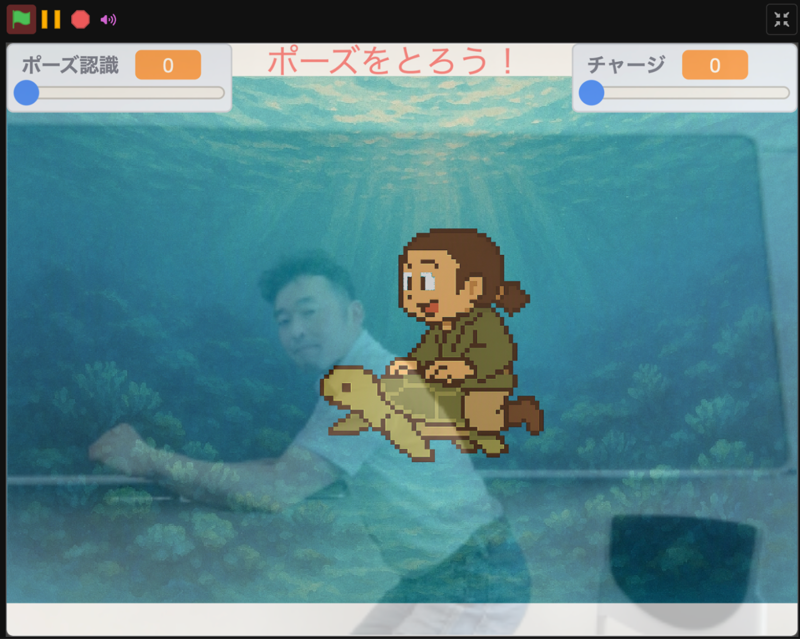

# TurboWarp紙芝居

[English](README.md) | 日本語

**ポーズで物語に参加する、AIインタラクティブ紙芝居**

TurboWarp紙芝居は、カメラの前で取ったポーズをきっかけに、登場人物、背景、音声、セリフ、分岐を進める参加型の紙芝居システムです。ポーズ認識にはTeachable Machine、作品の編集と実行にはTurboWarpを使い、台本とアセットからWeb／SB3形式の作品を作れます。

TurboWarp紙芝居はTurboWarpを基盤とする独立したプロジェクトであり、TurboWarp公式のプロジェクトではありません。

このリポジトリでは、紙芝居ランタイム、DSL、CLI／JavaScript API、配布用SB3、公開サイトを開発しています。操作方法、作者ガイド、コマンドリファレンス、トラブルシューティング、移行ノートの正本は[ドキュメントサイト](https://kubohiroya.github.io/turbowarp-kamishibai-docs/)です。



[公式サイト](https://kubohiroya.github.io/turbowarp-kamishibai-app/) · [Web版を体験する](https://sqs.prof.cuc.ac.jp/kamishibai/) · [SB3をダウンロードする](https://kubohiroya.github.io/turbowarp-kamishibai-app/downloads/) · [作り方を読む](https://kubohiroya.github.io/turbowarp-kamishibai-docs/) · [サンプルを見る](https://kubohiroya.github.io/turbowarp-kamishibai-samples/)

## このプロジェクトでできること

- 参加者のポーズ、キー入力、画面タッチで物語を進める
- YAMLまたは3.1／3.2テキストDSLで、シーン、分岐、セリフ、動き、音声、ポーズ認識を記述する
- TurboWarp上で台本をプレビューし、配布できる自己完結SB3を作る
- CLIで検証、live preview、SB3生成、旧DSL変換、アセット配布を自動化する
- DSL 4.0のcore actionをTurboWarpブロックまたはJavaScript APIから呼び出す

## どの版を使うか

|                      | 3.2.3                                | 4.0.0-rc.67                                |
| -------------------- | ------------------------------------ | ------------------------------------------ |
| 状態                 | 安定版・現在の推奨                   | リリース候補                               |
| 向いている用途       | 体験会、安定運用、既存の3.1／3.2作品 | YAML台本、ブラウザ制作、CLI／APIの先行検証 |
| 台本                 | 3.1／3.2テキストDSL                  | DSL 4.0 YAML                               |
| 入手先               | [ダウンロードページ][downloads]      | [ダウンロードページ][downloads]（SB3）     |
| 変更時に確認する文書 | [公開ドキュメント][docs]             | [4.0公開状況][current-release]             |

迷った場合は3.2.3を使ってください。4.0.0-rc.67は正式版前の候補であり、安定運用よりも4.0の制作フローやAPIを検証したい場合に適しています。公開済みの3.1／3.2作品は、4.0へ移行しなくても引き続き利用できます。

## まず体験する

ブラウザですぐ試す場合は、[公開中のWeb版](https://sqs.prof.cuc.ac.jp/kamishibai/)または[「浦島太郎」のサンプル](https://kubohiroya.github.io/turbowarp-kamishibai-samples/stories/urashima/web/)を開きます。カメラの利用を許可し、画面の案内に従ってポーズを取ってください。

作品ファイルをTurboWarpで開く場合は、[ダウンロードページ][downloads]から使用する系列のSB3を取得します。体験会で使う資料は[ワークショップ一覧](https://kubohiroya.github.io/turbowarp-kamishibai-docs/workshops/)から選べます。

## 制作を始める

### 安定した体験会には3.2を使う

イベントや既存の3.1／3.2作品には3.2.3を使います。3.2 SB3をダウンロードして[TurboWarp Editor](https://kubohiroya.github.io/turbowarp-extension-data-editor/editor.html?lang=ja)で開き、従来のテキストDSLと体験会の流れは[公開ドキュメント][docs]に従ってください。

### YAML projectには4.0を使う

現在のローカル候補は4.0.0-rc.67です。定義監査・SB3素材の宣言省略・簡易say/thinkブロックに対応する未公開候補です。凍結したStandard SB3の照合、provenance付きnpm公開、`latest`／`next`の同期、検証済みダウンロードページの配信がリリースジョブで完了してから、版付きのStandard SB3・Player・npmパッケージを利用できます。導入前に[現在の公開状況][current-release]を確認してください。ソースが候補版になっただけでは公開完了を意味しません。Standard SB3は`.k4.yml`台本またはproject directoryを開き、変更の検証、live preview、配布用SB3の生成まで行えます。

```yaml
kamishibai: '4.0'

controls:
  keymaps:
    production:
      Space: navigation.nextAction

scenes:
  opening:
    - wait: 1
    - goto: ending
  ending: []
```

より実用的な台本、アセット参照、ポーズモデル、分岐、吹き出し、ブラウザ条件、トラブルシューティングについては[DSL 4.0作者ガイド](https://kubohiroya.github.io/turbowarp-kamishibai-docs/dsl-author-guides/dsl-4.0-author-guide/)と[サンプルリポジトリ](https://github.com/kubohiroya/turbowarp-kamishibai-samples)を参照してください。

## CLI quick start

rc.64では認識の計算方式画面の初期言語を修正し、TurboWarpの表示言語、未指定ならブラウザ言語を使用します。タイトル・説明・操作ボタン・読み上げ用の名前は英語・日本語に対応し、アプリ内の言語切り替えにも追従します。Teachable Machine 4.0.2と計算方式選択はrc.63で追加しました。以前のrc.58ではpreview終了時の自己abort処理を修正しました。rc.51からrc.55でsealed保存した作品は引き続き利用できないため、元の台本からsourceまたはcompiled配布として再生成してください。以下のnpm例はrc.67のリリースジョブ完了後に実行し、事前に[公開状況][current-release]を確認してください。

[`@kubohiroya/turbowarp-kamishibai-app`](https://www.npmjs.com/package/@kubohiroya/turbowarp-kamishibai-app/v/4.0.0-rc.67)のCLIは、CI、再現可能なbuild、大規模project、配布profileの管理に向いています。Node.js 24.0.0以上とpnpm 11を使用し、検証するversionを固定して導入します。CLIコマンド名は`turbowarp-kamishibai`です。`tm-kamishibai`は非推奨の互換aliasとして残ります。

```bash
pnpm add --save-exact @kubohiroya/turbowarp-kamishibai-app@4.0.0-rc.67
pnpm exec turbowarp-kamishibai --help
pnpm exec turbowarp-kamishibai validate-dsl4 --input opening.k4.yml --format pretty
pnpm exec turbowarp-kamishibai preview-dsl4 --watch --base kamishibai-4-base.sb3 --project-root .
pnpm exec turbowarp-kamishibai build-dsl4 --base kamishibai-4-base.sb3 --project-root . --output dist/my-story.sb3
pnpm exec turbowarp-kamishibai convert-dsl4 --input legacy-story.txt --output opening.k4.yml
pnpm exec turbowarp-kamishibai author-block-dsl --input opening.k4.yml --base kamishibai-4-base.sb3 --output block-story.sb3
pnpm exec turbowarp-kamishibai export-block-dsl --input block-story.sb3 --output-dir dist
```

`author-block-dsl`は、シーンごとのまとまりに各命令の実ブロックを配置した、編集用SB3を生成します。TurboWarpで入力・接続・順序を編集して保存すると、`export-block-dsl`により変更内容をYAMLへ書き戻せます。include付きYAMLはラベル付き台本と`includeBlocks`へ変換し、書き戻しでも分割と参照関係を保持します。設定定義（control / asset / cover / textStyle / variable / loading / recognition）は`kamishibaiConfig [名前]`ハットへ分離します。Stage上の空名`kamishibai`から、空名の設定を最初に、続いて名前順に暗黙に読み込みます。設定ハットの同名多重定義は、空名同士も含め起動時エラーになります。生成形式・補助ブロック・互換性は[相互変換ガイド](https://kubohiroya.github.io/turbowarp-kamishibai-docs/4.0/dsl-author-guides/dsl-4.0-block-script-conversion-guide/)を参照してください。

セリフは`actor [actorName] say text [abc] seconds [10]`、心の声は`actor [actorName] think text [abc] seconds [10]`で、JSONを書かずに指定できます。どちらもYAMLの`actorName.say: {text: abc, seconds: 10}`／`actorName.think: {text: abc, seconds: 10}`に対応します。秒数は0以上です。textとsecondsだけのsay/thinkは台本生成時にも簡易版になります。装飾・入力待ち等の追加設定には既存のSPEC版を使います。

開発版の`audit-dsl4-definitions --input STORY.k4.yml --base PROJECT.sb3`では、asset・actorなどの未使用定義と未定義参照を検査できます。
`--remove-unused --output-dir NEW_DIR`で、未使用と確定した定義を除いた台本を別出力します。
SB3内素材の暗黙参照、cover・startSceneIndexの既定値、削除対象と復元手順は[定義・参照の監査ガイド](docs/dsl4-definition-audit.md)を参照してください。

完全なコマンドリファレンス、終了status、release workflowは[メンテナンスガイド](https://kubohiroya.github.io/turbowarp-kamishibai-docs/developer-guides/developer-guide/)を参照してください。

## 仕組み

```text
YAML + assets
    ↓
source frontend (parse, schema, semantic validation)
    ↓
browser preview / CLI build
    ↓
self-contained SB3
    ↓
TurboWarp runtime + Teachable Machine
```

preview、validator、builder、runtime loaderは同じStoryDocumentと診断を使います。local assetは作品SB3へ埋め込み、remote assetはintegrityと配布profileを明示します。build失敗時は既存成果物を保持し、検証済みcandidateだけを置き換えます。

実装の詳細はリポジトリ内の設計文書にあります。

- [DSL 4.0表層仕様](https://github.com/kubohiroya/turbowarp-kamishibai-app/blob/main/docs/design/dsl-4-surface.md): YAML契約、action surface、resource limit、model initialization、pose overlay
- [DSL 4.0 processing architecture](https://github.com/kubohiroya/turbowarp-kamishibai-app/blob/main/docs/design/dsl-4-processing-architecture.md): source frontend、StoryDocument、runtime境界、診断
- [Asset distribution profiles](https://github.com/kubohiroya/turbowarp-kamishibai-app/blob/main/docs/design/dsl-4-asset-distribution-profiles.md): local、remote、embedded、offline assetの挙動
- [DSL 4.0 動画再生（実験機能）](https://github.com/kubohiroya/turbowarp-kamishibai-app/blob/main/docs/design/dsl-4-video.md): 動画領域、plane・z-index、再生制御、有効化と切り戻し
- [Capability bundle and release contract](https://github.com/kubohiroya/turbowarp-kamishibai-app/blob/main/docs/design/dsl-4-capability-bundle-release.md): 固定extension package、embedded ID、artifact provenance、rollback policy
- [DSL 3.1/3.2 to 4.0 migration](https://github.com/kubohiroya/turbowarp-kamishibai-app/blob/main/docs/design/dsl-4-migration.md): 変換分類、warning、legacy artifact policy

現行4.0 candidateは`@kubohiroya/turbowarp-teachable-machine@4.1.0`と`kubohiroyatm` embedded Teachable Machine extension IDを使います。旧package名、CLI名、URL、SB3 IDは過去releaseとmigration noteにだけ残します。認識の計算方式は初回Autoです。単独HTMLでは縁の「ツール」にホバー／タップすると共通Dockが現れ、カメラと並ぶ「Teachable Machine」から設定を開けます。Dockの設定で上・下・左・右を選べます。緑の旗・停止ボタンと同じ操作列の設定ボタンからJavaScript（CPU）・WASM・WebGPUを選択できます。開発者APIと適用時のモデル解放については[認識の計算方式](https://github.com/kubohiroya/turbowarp-kamishibai-app/blob/main/docs/recognition-compute.ja.md)を参照してください。

## このリポジトリを開発する

rc.39の音声整理統合・音量・フェードは[音声再生仕様](docs/dsl4-audio.md)を参照してください。rc.38の公開物は保持します。

必要な環境:

- Node.js 24.0.0以上。CIはNode.js 24で実行し、Node.js 24の対応は終了します。
  buildのscriptはNode.js組み込みのtype strippingを使ってTypeScriptのmoduleを直接importします。
- pnpm 11
- SB3やブラウザ統合を変更する場合は、TurboWarpを実行できるdesktop環境
  このrepositoryはTypeScriptで記述します。`scripts/`配下を含め、新規moduleは`.ts`で追加します。
  `src/`に残るJavaScriptは生成物のみです。編集が必要なJavaScriptは、拡張せずTypeScriptへ変換します。

セットアップ:

```bash
pnpm install --frozen-lockfile
pnpm verify:quick
```

主な検証:

| Command             | Purpose                                                                |
| ------------------- | ---------------------------------------------------------------------- |
| `pnpm verify:quick` | Lint, type-check, and run the lightweight tests during development     |
| `pnpm verify:full`  | Run the CI-equivalent SB3, full test, E2E, site, and package checks    |
| `pnpm format`       | Check formatting with Prettier                                         |
| `pnpm test`         | Run the full unit and integration suite                                |
| `pnpm run build`    | Build the site and fetch verified Release SB3 assets into `site-dist/` |
| `pnpm build:lib`    | Compile `src/` into the published `dist/` package                      |
| `pnpm sb3:check`    | Regenerate and verify the current DSL 4.0 release candidate            |
| `pnpm pack:smoke`   | Verify the installable npm package contents                            |

サイトナビゲーションは [`@kubohiroya/turbowarp-kamishibai-site-navigation`](https://github.com/kubohiroya/turbowarp-kamishibai-site-navigation) が所有します。このリポジトリでは同期済みの`scripts/site-navigation.mjs`をGit管理せず、 build scriptからpackageを利用します。共通ナビゲーションを変更するときはpackage側を変更し、 releaseまたはpinを更新してからこのリポジトリのdependencyを更新します。

## ドキュメント

- [公開ドキュメント](https://kubohiroya.github.io/turbowarp-kamishibai-docs/): 操作、作者ガイド、コマンドリファレンス、トラブルシューティング、移行ノート、ワークショップ資料
- [ドキュメントsource](https://github.com/kubohiroya/turbowarp-kamishibai-docs): 公開文書の原稿とissue
- [v4.0.0-rc.67リリースノート][rc67]: 定義監査・宣言省略の既定値・簡易say/thinkブロック
- [v4.0.0-rc.65リリースノート][rc65]: 製作者情報、ファミリー依存、embedded pinの更新
- [v4.0.0-rc.58リリースノート][rc58]: 公開状態、互換性、検証済みartifact、rollback
- [Pagesの公開と過去版の保持](https://github.com/kubohiroya/turbowarp-kamishibai-app/blob/main/docs/pages-deployment.md)
- [Issue tracker](https://github.com/kubohiroya/turbowarp-kamishibai-app/issues): bug、提案、実装scope、受け入れ基準、rollback plan

## 関連プロジェクト

- [`kubohiroya/turbowarp-kamishibai-samples`](https://github.com/kubohiroya/turbowarp-kamishibai-samples): サンプル台本、画像、音声、SB3、Web作品
- [`kubohiroya/turbowarp-kamishibai-docs`](https://github.com/kubohiroya/turbowarp-kamishibai-docs): 利用者、作者、開発者、体験会向け文書
- [`kubohiroya/sb3-toolchain`](https://github.com/kubohiroya/sb3-toolchain): SB3の展開、検証、再構築、埋め込み拡張管理
- [`kubohiroya/turbowarp-teachable-machine`](https://github.com/kubohiroya/turbowarp-teachable-machine): TurboWarp向けポーズ認識拡張

## ライセンス

個別表示のない、本プロジェクトが著作権を持つソフトウェアと素材にはMPL-2.0を適用します。第三者著作物と素材ごとの条件は[`LICENSES.md`](LICENSES.md)を参照してください。ドキュメントとサンプルには、それぞれのリポジトリで示す条件が適用されます。

[docs]: https://kubohiroya.github.io/turbowarp-kamishibai-docs/
[downloads]: https://kubohiroya.github.io/turbowarp-kamishibai-app/downloads/
[rc58]: https://github.com/kubohiroya/turbowarp-kamishibai-app/blob/main/docs/releases/v4.0.0-rc.58.md
[rc65]: https://github.com/kubohiroya/turbowarp-kamishibai-app/blob/main/docs/releases/v4.0.0-rc.65.md
[rc67]: https://github.com/kubohiroya/turbowarp-kamishibai-app/blob/main/docs/releases/v4.0.0-rc.67.md
[current-release]: https://github.com/kubohiroya/turbowarp-kamishibai-app/releases/tag/v4.0.0-rc.67

### 物語の反復と条件分岐（DSL 4.0 RCのStandard機能）

rc.44のStandardでは有限反復・条件分岐・型付き参照を実験flagなしで利用できます。rc.43以前は対応しません。低水準の既定OFFと明示的な無効化、旧4.0の意味は維持します。rc.46では同じStandard機能をnpmとSB3の公開対象に揃えます。rc.49ではKVS 0.2.1を使用し、通常npm依存経路で解放失敗後の再試行を確認しています。これらの過去の変更は[rc.58リリースノート][rc58]に記録されています。rc.66の公開は[現在の公開状況][current-release]で確認してください。[開発仕様・切戻し](https://github.com/kubohiroya/turbowarp-kamishibai-app/blob/main/docs/design/dsl-4-narrative-control.md)を参照してください。
